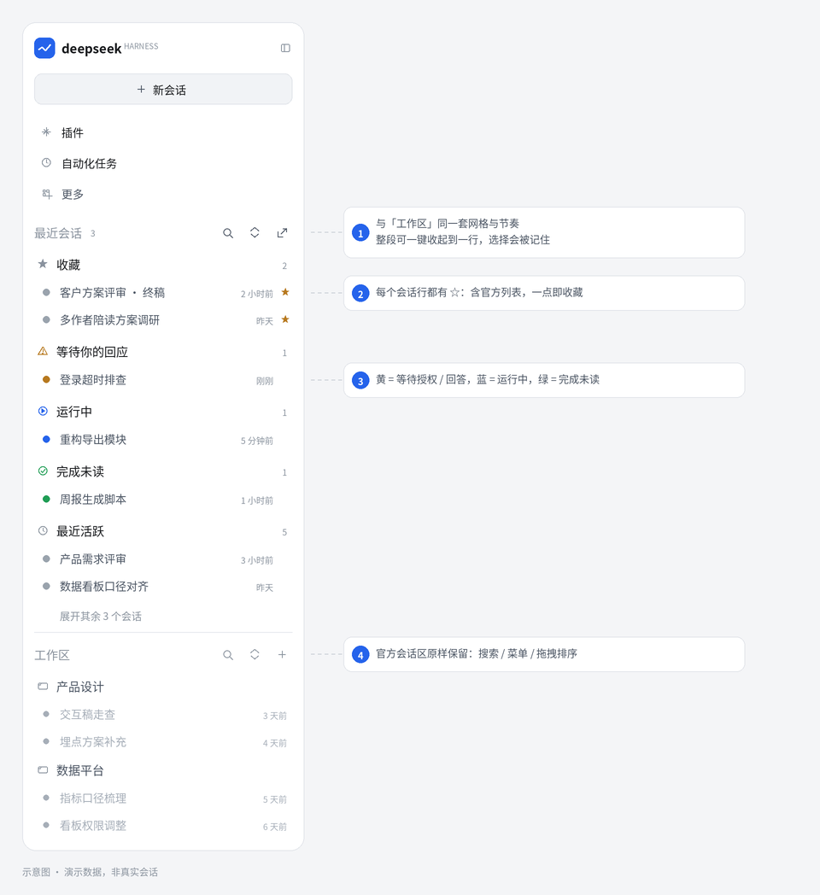
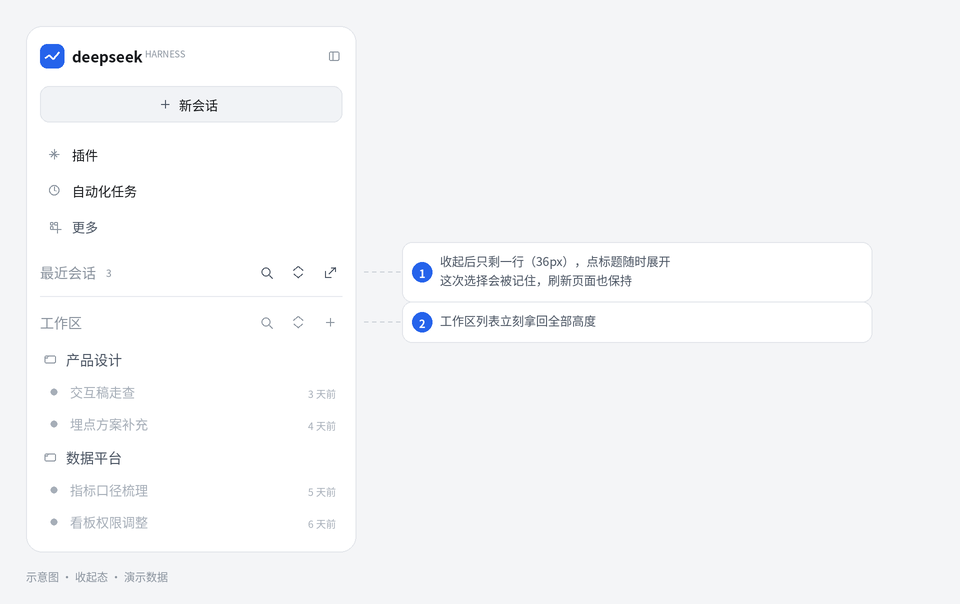

# 最近会话 · dsh-recent-sessions

<sub>中文 · <a href="README.en.md">English</a></sub>

> 像官方「工作区」一样长在左侧栏里的「最近会话」—— 收藏、运行中、等待你的回应、完成未读、最近活跃，一屏直达；
> 不用时**一键收起到一行**，标题右侧 🔍 还能**就地搜索**，**每个会话行都有 ☆ 一点即收藏**。



<sub>示意图：演示数据，非真实会话</sub>



<sub>收起态：整段只剩一行（36px），点标题随时展开，选择会被记住；工作区立即拿回全部高度</sub>

🌐 **落地页 / 在线说明**：<https://tianxiaz.github.io/dsh-recent-sessions/>

给 [DeepSeek Harness](https://github.com/deepseek-ai/deepseek-harness) 的**左侧栏**加一个「最近会话」分区。它和官方「工作区」共用同一套网格与交互（36px 分区标题 / 34px 分组行 / 32px 会话行 / 28px 溢出行），看起来就是官方侧边栏的一部分：不另开页面、不是悬浮面板，也不改变官方会话浏览区的任何行为。

**顺手的地方**：

- **每个会话行都带 ☆**——包括官方的会话列表，悬停即可一键收藏 / 取消，不用打开会话、也不用拖拽；
- 整段可以收起到一行（不占工作区列表的高度，选择会被记住）；
- 标题右侧的 🔍 直接把标题行变成输入框，命中文字高亮、`Enter` 打开第一条；`↑`/`↓` 可在分区内键盘浏览；
- 收藏里可以拖拽排序，悬停收藏行还会出现 ↑「移到最前」；
- 对某个分类手动展开或收起后，硬刷新也会保持你的选择；分区内的滚动位置也会记住；
- 黄点行直接写「待授权 / 待回答」，不用点进去才知道在等什么。

**它解决什么问题**：任务一多，「哪个在跑、哪个跑完了还没看、哪个在等我授权或回答、我常回访的是哪几个」就得在会话列表里翻半天。这个分区把 **收藏 / 运行中 / 等待你的回应 / 完成未读 / 最近活跃** 五类固定在最上面，配黄 / 蓝 / 绿状态点，一眼就知道下一步该点哪里；收藏可以点 ☆，也可以把会话行直接拖进「收藏」分组。

它以插件形式接管左侧栏外壳，因此这个分组**就在工作区分组上方**，而不是另开一个页面；官方会话浏览区（搜索、会话 `…` 菜单、拖拽排序、归档筛选、工作区增删改）原样保留、原样工作。

默认只统计**属于某个工作区**的会话：未分组的会话（例如在 `/tmp` 里用 CLI 跑的一次性任务）**只有在你需要回应它时**才会出现（等待授权 / 待回答），其余情况（空闲、运行中、完成未读）都留在下方官方列表的「未分组」里。

## 视觉与交互细节

- **分区标题**与「工作区」同规格：高 36px、14px/20、`label-tertiary`、左侧 4px 内边距，标题完整显示不截断；标题可点击，右侧三个 28×28 图标动作：`搜索会话`、`收起/展开`、`在面板中打开`。
  - **一键收起到一行**：点标题（或「收起」）整段折叠成一行 36px，工作区列表立刻拿回全部高度；状态记在浏览器里，下次打开保持。
  - 面板页不再占用左侧面板列表的一行（它与分区重复），需要时点标题右侧的 ⤢ 打开。
- **分区内搜索**：点标题右侧的 🔍 直接把标题行变成输入框，按会话标题 / 工作区名筛选本分区里的会话；`Esc` 或 × 退出，`Enter` 打开第一条，命中文字高亮。
- **分类**与工作区分组行同规格：高 34px、16×20 图标槽、标题 14px/20；**悬停时图标换成实心三角**，点击折叠/展开；右侧显示 10px 数量。
  - **默认展开规则**：**收藏永远默认收起**（为空时右侧显示「拖入或点 ☆ 收藏」，非空时显示数量）；有「等待你的回应 / 运行中 / 完成未读」时，这些分类默认展开、最近活跃默认收起；三类都没有时，最近活跃默认展开。
  - **你的折叠选择会被记住**：一旦手动展开/收起了某个分类，该选择写入 `localStorage`，**硬刷新或重开页面后都会恢复**（包括"收藏是展开的"这个状态）。
- **会话行**与官方会话行同规格：高 32px、状态点占 16×20 槽、标题 14px/20、右侧 10px 相对时间；**悬停时隐藏时间、浮出 ☆**；当前打开的会话常驻选中底色。
- **溢出行**沿用官方 `展开其余 N 个会话 / 收起`（28px、12px、`label-tertiary`）。
- 行间距 2px、分组间距 4px，与官方列表同一套节奏；分类之间与工作区之间用 1px 分隔线区隔。

## 收藏

三种方式：

1. 会话行悬停时点 `☆`（官方会话行上的新增按钮）；
2. 把会话行**拖进「最近会话」分组**（从下面官方列表直接拖上来即可）；
3. 点分区标题右侧的 ⤢ 打开面板页，在里面拖到「收藏」区，或拖到某条收藏上调整顺序。

收藏顺序即展示顺序，保存在本机浏览器（见「数据」）。

收藏不会把会话从「最近活跃」里拿走：最近活跃是**纯时间列表**（最近碰过的 5 个会话，不管有没有被收藏），被收藏的那条行尾带一个 **★** 作为提示；它在「收藏」里同时出现是刻意的。

## 安装

**插件市场（推荐）**：Plugins → Discover → **Add index source**，粘贴下面的索引地址，然后在卡片上点安装：

```
https://tianxiaz.github.io/dsh-recent-sessions/market/index.json
```

> GitHub Pages 缓存约 10 分钟，发版后很快生效。若该地址在你所在网络不通，可换用 jsDelivr 镜像（分支缓存约 12 小时）：
> `https://fastly.jsdelivr.net/gh/tianxiaz/dsh-recent-sessions@main/market/index.json`

**命令行**：

```bash
dsh plugin --profile <你的 profile> add "git+https://github.com/tianxiaz/dsh-recent-sessions.git"
```

**本地目录**（开发/自用）：

```
plugin_manager install_bundle  <绝对路径>/dsh-recent-sessions
```

安装后**硬刷新页面**即可。

## ⚠️ 侧栏接管说明（重要）

DSH 左侧栏的两个关键位都是**单占位槽**，插件无法"在官方分组旁边插入一节"：

| 槽 | 官方占用者 | 性质 |
|---|---|---|
| `sidebar` | `@deepseek-ai/dsh-client-ui-sidebar` 的 SidebarRoot | 整个左列外壳（品牌行、新会话、面板列表、页脚） |
| `sidebar.workspaces` | `@deepseek-ai/dsh-client-ui-workspace` 的 WorkspaceBrowser | 会话浏览区 |

所以本插件的做法是：**接管外壳、复用会话区**。

- bundle patch 里 `- id: ui-sidebar` + `disabled: true`，禁用官方外壳；
- 本插件注册 `sidebar` 占位，声明与官方**同名**的 8 个子槽（`brand.mark` / `brand.name` / `toggle.badge` / `panellist` / `panellist.actions` / `workspaces` / `settings` / `footer.action`），并把 `sidebar.workspaces` **原样渲染**官方 WorkspaceBrowser；
- 同时提供 `shell.leading`（macOS 侧栏完全收起时的"打开侧栏 / 新会话"两个窗口按钮），否则收起后无处点开。

这意味着：

- 品牌行、新会话按钮、面板图标列表、页脚由本插件渲染（几何与配色对齐官方，但**不是逐像素一致**）；
- DSH 官方侧栏以后若改动，本插件需要同步更新（见下）；
- 不想要了，禁用/卸载本 bundle 即可恢复官方侧栏（会同时失去面板页与 `☆` 按钮）。

**崩溃隔离**：接管意味着"插件挂了 = 左栏没有占位者"，所以侧栏整体套了一层 error boundary。任何子组件抛错时不会留下空白列，而是退化为：顶部一句提示 + 「重新加载」按钮 + **原样渲染的官方会话列表**（仍可正常选会话、切工作区）。

**空间分配**：始终优先保证工作区列表 —— 工作区至少拿到可用高度的 **55%**（且不少于 160px），「最近会话」最多占 **45%**、上限 420px 并在内部滚动；窗口被压得很矮时，最近会话会**只保留标题一行**，把高度全部让给工作区。拖动工作区里的会话时，「最近会话」还会**临时折叠成一行**，把高度让出来，标题同时变成投放区。

## 兼容性与维护

- 目标版本：DSH `^0.2.1-rc.5`（`engines.dsh`）。
- 已知失败模式：若某版 DSH 里 `ui-sidebar` 这个行 **id 改名或消失**，patch 会 warn + skip，本插件注册 `sidebar` 时与官方外壳冲突 → 本插件整体不生效（官方 UI 保持不变）。修复：更新 `cordis.patch.yml` 里的行 id、必要时重新对齐外壳。
- 升级 DSH 后的核对清单（都在 `client.js` 的 `sidebar shell` 区）：
  1. `sidebar` 槽的 owner props 是否仍是 `{ collapsed, width }`；
  2. 需要声明/渲染的子槽集合是否仍是那 8 个；
  3. 官方 `SidebarRoot` 的几何（logo 行 60/36px、新会话按钮 38/36px、面板行 36px、折叠内边距 18/10/6）是否变化 → 同步 `SHELL_CSS`；
  4. `sidebar.panellist` 的 owner props（`size` / `active`）与 `sidebar.workspaces` 的 owner props（`wide` / `expandSidebar`）；
  5. `shell.leading` 的挂载条件（macOS 且侧栏收起）；
  6. 官方 WorkspaceBrowser 是否仍以 `sidebar.workspaces` 单占位方式注册。

## 数据与隐私

- 纯前端插件，**不发起任何网络请求**（除 DSH 自身）。
- 收藏与折叠状态存在当前浏览器 `localStorage`：
  `dsh.recent-sessions.favorites.v1`（收藏的会话 id，按展示顺序）、`dsh.recent-sessions.inline.open.v1`（整段是否收起到一行）、`dsh.recent-sessions.cats.v1`（每个分类手动折叠/展开的选择）。
- 已归档会话不出现在快捷列表里（收藏仍保留，取消归档后自动回来）；收藏按站点区分，换浏览器/换域名不共享。

## 许可

MIT，见 [LICENSE](./LICENSE)。
